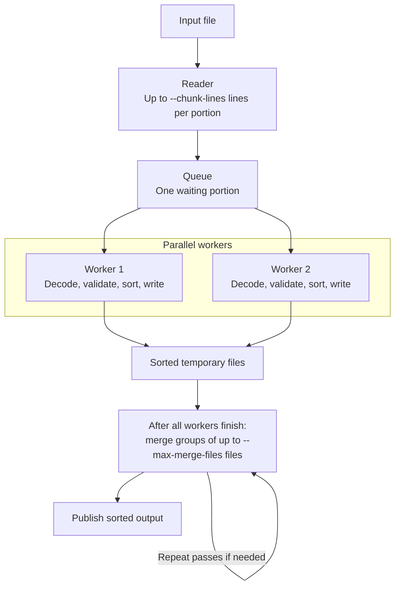

# 3dEYE large-file sorting assignment

Two .NET 10 console applications: a **generator** that creates test files with repeated text, and an **external sorter** that processes files in portions. Production code uses only the standard library; tests use xUnit.

Records have the form `Number. Text`. Sorting compares the text first, then the number:

| Input | Sorted output |
| --- | --- |
| `415. Apple` | `1. Apple` |
| `30432. Something something something` | `415. Apple` |
| `1. Apple` | `2. Banana is yellow` |
| `32. Cherry is the best` | `32. Cherry is the best` |
| `2. Banana is yellow` | `30432. Something something something` |

[Quick start](#quick-start) · [Sorting algorithm](#sorting-algorithm) · [Arguments](#arguments) · [Decisions](#decisions) · [Project structure](#project-structure) · [Verification](#verification)

## Quick start

Requires the **.NET 10 SDK**. Run from the repository root.

**Build and test**

```text
dotnet restore 3deyeLargeFile.sln --configfile NuGet.Config
dotnet build 3deyeLargeFile.sln -c Release --no-restore
dotnet test 3deyeLargeFile.sln -c Release --no-build --no-restore
```

**Generate a 16 MB sample and sort it**

Create the `data` directory first. Output files must not already exist.

```text
mkdir data
dotnet run --project 3deyeLargeFile.Generator -c Release --no-build -- --output data/input.txt --size 16 --seed 42
dotnet run --project 3deyeLargeFile.Sorter -c Release --no-build -- --input data/input.txt --output data/sorted.txt --temp-dir data
```

Both commands print progress and a final summary. Pass only `--help` after `--` to see the available arguments.

All MB arguments accept positive whole numbers without suffixes: **1 MB = 1024 × 1024 bytes**. For example, `--size 1024` requests a 1 GiB file.

## Sorting algorithm

The sorter builds sorted temporary files, then merges them. The diagram shows two workers; `--workers` controls their number.



1. **Read portions.** [`SortedChunkBuilder.ReadChunksAsync`](3deyeLargeFile.Sorter/SortedChunkBuilder.cs) uses `LineReader` to read at most `ChunkLines` lines into each `RecordBatch`. A full queue pauses the reader.
2. **Sort in parallel.** `SortedChunkBuilder.ProcessChunksAsync` decodes and validates a portion, then `SortAndWriteChunk` sorts its valid records and writes a temporary file. Invalid records are logged and skipped.
3. **Reduce the file count.** [`SortedChunkMerger.MergeAsync`](3deyeLargeFile.Sorter/SortedChunkMerger.cs) merges groups until the remaining files fit into one final merge. Merge groups run sequentially.
4. **Merge in order.** [`ChunkGroupMerger.Merge`](3deyeLargeFile.Sorter/ChunkGroupMerger.cs) keeps the first unread record from each file in a priority queue. It writes the smallest record and reads the next one from that same file. This produces a globally sorted result, including records originally at the end of the input.
5. **Publish the result.** [`ExternalSorter.SortAsync`](3deyeLargeFile.Sorter/ExternalSorter.cs) publishes the completed file after the merger verifies the record count. Temporary files are removed as they are consumed.

**Memory control:** `--chunk-lines` directly limits the number of lines per portion. With two workers, at most four portions are in flight: two being processed, one queued, and one being read. At the default limit, that is up to 400,000 lines across portions, plus the reader's current line. Actual RAM depends on line lengths, decoded strings, buffers, and runtime overhead. Smaller portions or fewer workers retain less data; this is not a fixed MB budget.

Empty and malformed lines occupy slots until worker validation. Oversized lines are discarded by the reader. The final portion may be smaller, and portions with no valid records produce no temporary file.

## Arguments

### Generator

| Argument | Default | Meaning |
| --- | --- | --- |
| `--output <path>` | Required | Destination file. |
| `--size <MB>` | Required | Target file size; at least one complete repeated group is generated. |
| `--seed <int>` | Random | Reproducible seed, printed on completion. |
| `--repeated-percent <int>` | `20` | Minimum percentage of records with repeated text, including first occurrences; 1–100. |
| `--copies-per-text <int>` | `2` | Intended occurrences per completed group, including the first; at least 2. |
| `--shuffle-buffer-size <MB>` | `8` | Estimated string storage for records awaiting shuffling. |
| `--min-text-length <int>` | `16` | Minimum text length. |
| `--max-text-length <int>` | `128` | Maximum text length. |

Add these arguments to the generator command to exercise different repetition patterns:

| Profile | Arguments | Intended distribution |
| --- | --- | --- |
| Pairs | `--repeated-percent 80 --copies-per-text 2` | At least 80% of records belong to pairs. |
| Larger groups | `--repeated-percent 80 --copies-per-text 1000` | At least 80% of records belong to groups intended to contain 1,000 occurrences each. |

Repeated **text** does not imply an identical full record: each occurrence receives an independently generated number. Random text collisions are accepted and may increase repetition counts. A later final group may be incomplete, with at least two occurrences.

[`RecordSource`](3deyeLargeFile.Generator/RecordSource.cs) creates records on demand; [`ShuffledWriter`](3deyeLargeFile.Generator/ShuffledWriter.cs) shuffles and writes one buffer at a time; [`FileGenerator`](3deyeLargeFile.Generator/FileGenerator.cs) coordinates generation and publication. Shuffling happens within each buffer, not across the entire file.

<details>
<summary>Generation guarantees and size limits</summary>

- Numbers range from 1 through 999,999,999. Texts contain random ASCII letters and spaces; Unicode input is covered by sorter tests.
- At least one complete group of `CopiesPerText` occurrences is generated, even for a tiny target or a 1% repetition setting. This group counts toward the minimum percentage.
- The target size includes numbers, delimiters, and LF terminators. If the minimum group fits within the target, overshoot is smaller than two maximum-sized records. If that group alone exceeds the target, generating the whole group takes priority.
- The source retains one repeated text and its remaining copy count. Storage does not grow with file size or group size.
- Validation limits estimated text construction and shuffle storage to 64 MB. With default text lengths, shuffle buffers of 1–31 MB are accepted; longer texts may lower that limit. Runtime overhead is additional.
- Use the printed seed and the same generation options to reproduce file bytes on the same application/runtime version. A separate random sequence for shuffling preserves generated contents when only the shuffle-buffer size changes.

</details>

### Sorter

| Argument | Default | Meaning |
| --- | --- | --- |
| `--input <path>` | Required | Source file. |
| `--output <path>` | Required | Destination file. |
| `--chunk-lines <int>` | `100000` | Maximum lines per portion; positive integer. |
| `--workers <int>` | Up to `2` | Workers that decode, validate, sort, and write portions. |
| `--temp-dir <path>` | System temp | Parent directory for temporary files. |
| `--max-merge-files <int>` | `32` | Maximum input files opened per merge; at least 2. |
| `--max-line-size <MB>` | `1` | Maximum UTF-8 bytes per record, excluding terminators; up to 2047 MB. |

The default worker count is `min(2, Environment.ProcessorCount)`. Merge passes use `--max-merge-files` directly.

## Decisions

| Choice | Behavior |
| --- | --- |
| Text comparison | Case-sensitive `InvariantCulture`, as clarified for the assignment. |
| Numeric comparison | Positive `long` values, compared numerically in ascending order. |
| Invalid source records | Skip and log the physical line number and reason to stderr; include the count in the final summary. |
| Duplicate preservation | Keep every valid occurrence and its original spelling. Equal keys have no guaranteed relative order. |
| Portion sizing | Count lines directly to keep configuration and implementation straightforward. |
| Output publication | Write to a temporary file beside the destination, then rename it after successful completion. Existing output is an error. |

<details>
<summary>Exact record format</summary>

| Topic | Rule |
| --- | --- |
| Encoding | Strict UTF-8; accept an initial BOM, write without a BOM. |
| Delimiter | The first literal `. ` separates the number and text. Additional spaces belong to the text. |
| Number | ASCII digits representing 1–9,223,372,036,854,775,807. Leading zeros are accepted; signs, whitespace, fractions, zero, and overflow are invalid. |
| Text | May be empty. Preserve Unicode representation, spaces, and periods; no trimming or normalization. CR and LF are not allowed within a record. |
| Input endings | LF, CRLF, mixtures, and an unterminated final record are accepted. Bare CR is invalid. A final terminator adds no extra empty record. |
| Output endings | LF after every record. Original valid record contents are preserved. |
| Empty input | Produces an empty output. Blank lines are invalid records. |
| Oversized records | Skip and log before allocating the full line; the size limit excludes the terminator and initial BOM. |
| Equal keys | Texts may compare equal despite different Unicode representations; numeric spellings may also differ. Preserve all such records without promising a stable order. |

</details>

<details>
<summary>Files, failures, and exit codes</summary>

Input and output must designate different files. Input files and parent directories must exist; the input must remain unchanged during sorting. Path validation accounts for symbolic links and Windows file aliases, including hard links.

Each operation owns its temporary files. Cancellation or failure stops all workers before cleanup. The original failure is propagated; invalid data in a temporary chunk is fatal. Ctrl+C requests cancellation. Forced termination or power loss can leave temporary files behind.

Allow space for temporary chunks and the staged output: additional disk occupancy can approach twice the input size, plus a safety margin. The original input is retained.

| Exit code | Meaning |
| --- | --- |
| `0` | Success or help; skipped source records still count as success. |
| `1` | I/O or other operation failure. |
| `2` | Invalid arguments or paths, including an existing output. |
| `3` | Invalid temporary chunk data. |
| `130` | Cancellation. |

</details>

## Project structure

| Project | Responsibility |
| --- | --- |
| [3deyeLargeFile.Generator](3deyeLargeFile.Generator) | Record generation, repetition settings, and buffered shuffling. |
| [3deyeLargeFile.Sorter](3deyeLargeFile.Sorter) | Reading portions, parallel sorting, and merge passes. |
| [3deyeLargeFile.Shared](3deyeLargeFile.Shared) | Record format, CLI handling, and output publication. |
| [3deyeLargeFile.Tests](3deyeLargeFile.Tests) | Unit, integration, and CLI tests. |
| [3deyeLargeFile.Verifier](tools/3deyeLargeFile.Verifier) | Independent streaming verification of benchmark files. |

## Verification

**251 test cases pass** in Release on Windows x64 with .NET 10.0.12. Builds treat warnings as errors.

| Area | Covered cases |
| --- | --- |
| Format and ordering | Positive Int64 limits, Unicode and case comparison, numeric ties, BOM, line endings, invalid UTF-8, oversized lines. |
| External sort | Exact record preservation, duplicates, single-line and partial portions, multiple merge passes with 1/2/4 workers. |
| Failures | Reader/worker errors, cancellation, temporary record loss, publication races, existing output, path aliases. |
| Generator | Repetition profiles, tiny targets, random collisions, seeds, shuffle budgets, and record preservation across buffer sizes. |
| CLI and verifier | Defaults, argument validation, diagnostics, exit codes, corruption detection, and failure cancellation. |

The optional verifier independently checks ordering, record counts, and a fingerprint of the record multiset. Small integration tests compare complete record sets directly. The verifier expects valid source data; skip behavior is tested separately.

**Current measurements (2026-09-30):** Release on an Intel Core i7-12700H, with 100,000 lines per portion and at most 32 files per merge.

| Input | 1 worker | 2 workers | 8 workers |
| --- | ---: | ---: | ---: |
| 1 GiB | 30.07 s | 24.79 s | 20.72 s |
| 10 GiB | 377.75 s | 316.11 s | 278.30 s |

The 1 GiB values are medians of three runs; 10 GiB was measured once per configuration. The 8-worker runs were a later batch using the same binaries and byte-identical inputs. All twelve results passed independent verification. On 10 GiB, peak working set increased from 244.4 MiB with two workers to 648.0 MiB with eight.

See [BENCHMARKS.md](BENCHMARKS.md) for generator timings, input distributions, individual runs, disk usage, and measurement conditions. The assignment's approximately 100 GB case and Linux execution have not been verified.
